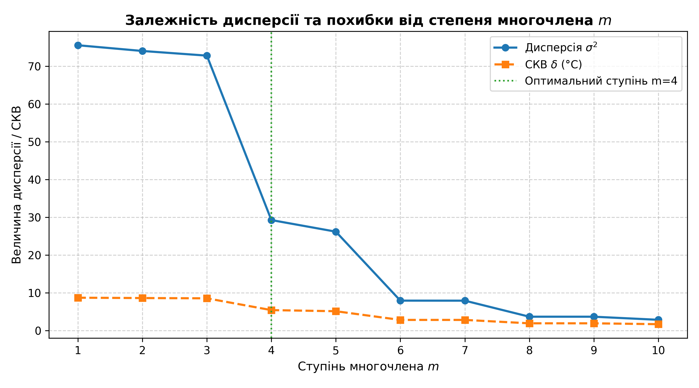
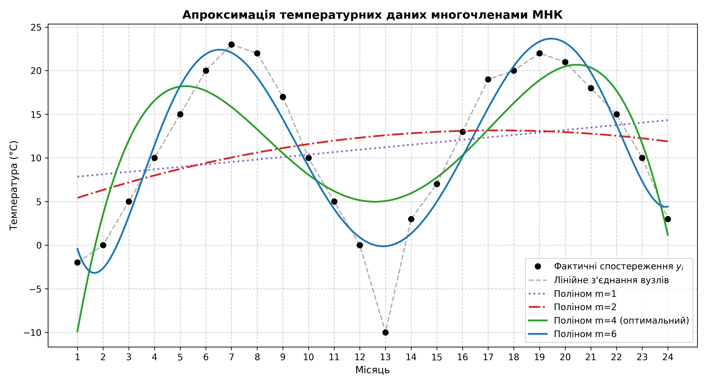
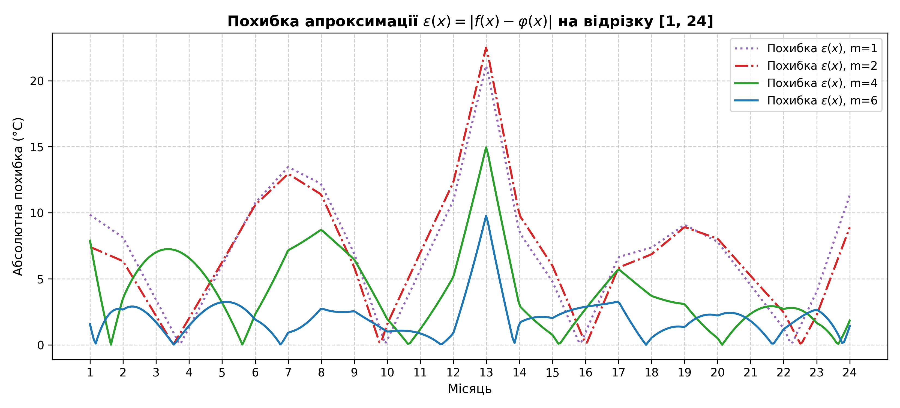
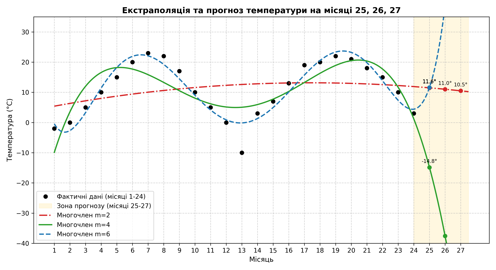

# Лабораторна робота №3: Метод найменших квадратів (МНК)

Реалізація методу найменших квадратів для знаходження алгебраїчних многочленів найкращого квадратичного наближення табличної функції середньомісячних температур за 24 місяці.

---

## 📌 Постановка задачі

Задано дискретний набір значень середньомісячної температури $f_i$ у вузлах $x_i$ ($i = 0, \dots, n$, де $n = 23$, всього 24 місяці).

Необхідно побудувати апроксимуючий многочлен степеня $m$ ($m < n$):
$$\varphi(x) = \sum_{j=0}^{m} a_j x^j = a_0 + a_1 x + a_2 x^2 + \dots + a_m x^m$$

з умови мінімуму суми квадратів відхилень:
$$S = \sum_{i=0}^{n} (\varphi(x_i) - f_i)^2 \to \min$$

Прирівнюючи частинні похідні $\frac{\partial S}{\partial a_k} = 0$ ($k = 0, \dots, m$), отримуємо нормальну систему лінійних алгебраїчних рівнянь:
$$\sum_{j=0}^{m} b_{kj} a_j = c_k, \quad k = 0, \dots, m$$

де:
$$b_{kj} = \sum_{i=0}^{n} x_i^{k+j}, \qquad c_k = \sum_{i=0}^{n} f_i x_i^k$$

Система розв'язується **методом Гауса з вибором головного елемента по стовпцях**.

Критерій якості наближення — дисперсія $\sigma^2$ та середньоквадратичне відхилення $\delta$:
$$\sigma^2 = \frac{1}{n+1} \sum_{i=0}^{n} (\varphi(x_i) - f_i)^2, \qquad \delta = \sqrt{\sigma^2}$$

---

## 📁 Структура проєкту

```text
Lab3/
├── data/ (або корінь)
│   └── temperature.csv        # Вхідний файл спостережень (24 місяці)
├── plots/
│   ├── dispersion_vs_degree.png      # Графік залежності дисперсії від степеня m
│   ├── approximation_comparison.png  # Порівняння апроксимацій та фактичних даних
│   ├── approximation_errors.png      # Розподіл похибок на відрізку [1, 24]
│   └── forecast_extrapolation.png    # Екстраполяція та прогноз на місяці 25-27
├── main.py                    # Основна програма розрахунку МНК
├── tabulation_errors.txt      # Результати табулювання похибок з кроком h1 = 0.05
├── Report_Lab3.docx           # Звіт у форматі Microsoft Word
├── Report_Lab3.pdf            # Звіт у форматі PDF
├── requirements.txt           # Залежності проєкту (numpy, matplotlib, python-docx)
├── .gitignore                 # Виключення тимчасових файлів
└── README.md                  # Документація проєкту
```

---

## 📊 Результати розрахунків

### Порівняння характеристик многочленів степенів $m = 1 \dots 10$

| Ступінь $m$ | Дисперсія $\sigma^2$ | СКВ $\delta$ (°C) | Характеристика |
| :---: | :---: | :---: | :--- |
| **1** | 75.5229 | 8.6904 | Лінійний тренд; не описує коливання |
| **2** | 74.0065 | 8.6027 | Параболічний тренд; не відповідає сезонності |
| **3** | 72.7766 | 8.5309 | Недостатньо екстремумів для двох сезонів |
| **4** | **29.2463** | **5.4080** | **Якісний перелом (2 літа, 2 зими). Оптимум за методичкою** |
| **5** | 26.1734 | 5.1160 | Незначне зменшення похибки |
| **6** | **7.9187** | **2.8140** | **Висока точність опису річних амплітуд** |
| **7** | 7.9083 | 2.8122 | Збігається з $m=6$ |
| **8** | 3.6652 | 1.9145 | Початок крайових осциляцій |
| **9** | 3.6619 | 1.9136 | Практично ідентично до $m=8$ |
| **10** | 2.8432 | 1.6862 | Числова нестійкість нормальної матриці ($\text{cond} \sim 10^{27}$) |

### Оптимальний многочлен ($m = 4$)
$$\varphi_4(x) = -29.428 + 23.012x - 3.6842x^2 + 0.21867x^3 - 0.004287x^4$$

---

## 📈 Графічні результати

| Залежність дисперсії від степеня $m$ | Порівняння апроксимацій |
| :---: | :---: |
|  |  |

| Розподіл похибок на відрізку $[1, 24]$ | Екстраполяція та прогноз на місяці 25–27 |
| :---: | :---: |
|  |  |

---

## 🔮 Прогноз середньомісячної температури на місяці 25, 26, 27

| Ступінь $m$ | Місяць 25 (Січень) | Місяць 26 (Лютий) | Місяць 27 (Березень) | Оцінка адекватності |
| :--- | :---: | :---: | :---: | :--- |
| **$m = 1$** | $+14.61$ °C | $+14.89$ °C | $+15.17$ °C | Нереалістично тепла зима |
| **$m = 2$** | $+11.48$ °C | $+11.02$ °C | $+10.49$ °C | Ігнорує сезонний спад |
| **$m = 4$ (опт.)** | $-14.84$ °C | $-37.58$ °C | $-68.36$ °C | Катастрофічне падіння за межами відрізка |
| **$m = 6$** | $+11.60$ °C | $+38.52$ °C | $+98.63$ °C | Катастрофічне зростання за межами відрізка |

> **Висновок щодо екстраполяції:** Алгебраїчні многочлени високих степенів відмінно підходять для згладжування всередині інтервалу спостережень, проте є непридатними для екстраполяції періодичних процесів через стрімку степеневу розбіжність за межами вибірки. Для кліматичних прогнозів рекомендовано використовувати ряди Фур'є або моделі SARIMA.

---

## 🚀 Інструкція із запуску

### 1. Клонування та перехід у папку проєкту
```bash
git clone git@github.com:Stanislavwx/computing-methods-and-technologies.git
cd computing-methods-and-technologies/Lab3
```

### 2. Створення віртуального середовища та встановлення залежностей
```bash
python3 -m venv venv
source venv/bin/activate       # Linux/macOS
# .\venv\Scripts\activate      # Windows

pip install -r requirements.txt
```

### 3. Запуск програми
```bash
python main.py
```
Програма автоматично:
- Зчитає `temperature.csv`;
- Розв'яже нормальні системи рівнянь для $m = 1 \dots 10$;
- Збереже таблицю похибок у `tabulation_errors.txt`;
- Згенерує графіки високої роздільної здатності в папку `plots/`.
