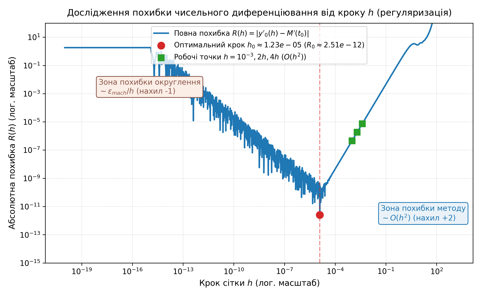
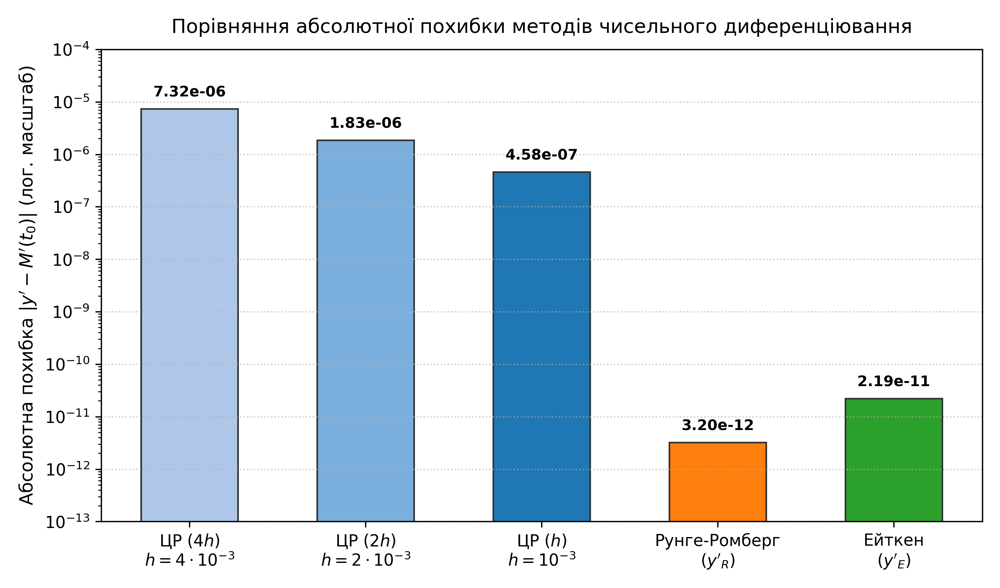
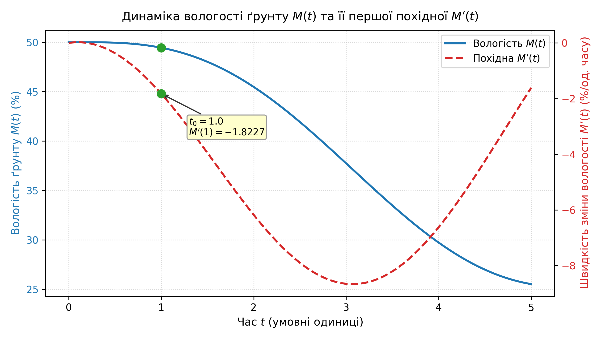

# Лабораторна робота №4: Чисельне диференціювання. Метод Рунге-Ромберга. Метод Ейткена

Дослідження точності формул чисельного диференціювання, явища регуляризації кроку (компроміс між похибкою методу та похибкою заокруглення) та підвищення точності за допомогою екстраполяції Рунге-Ромберга і прискорення збіжності методом Ейткена.

---

## 📌 Постановка задачі

У системі автоматичного поливу необхідно оцінювати швидкість зміни вологості ґрунту $M'(t)$ у момент часу $t_0 = 1.0$.

Вологість описується аналітичною функцією:
$$M(t) = 50e^{-0.1t} + 5\sin(t)$$

Точна похідна:
$$M'(t) = \frac{dM}{dt} = -5e^{-0.1t} + 5\cos(t)$$
$$M'(1.0) = -5e^{-0.1} + 5\cos(1) \approx -1.822675560839$$

### Завдання:
1. Знайти аналітичне значення похідної $M'(1)$.
2. Дослідити поведінку повної похибки $R(h) = |y'_0(h) - M'(1)|$ на сітці кроків $h \in [10^{-20}, 10^3]$. Визначити оптимальний крок регуляризації $h_0$ та мінімальну похибку $R_0$.
3. Для прийнятого робочого кроку $h = 10^{-3}$ (0.001) обчислити центральні різниці для сітки кроків $h$, $2h$, $4h$:
   $$y'_0(h) = \frac{M(t_0+h) - M(t_0-h)}{2h}$$
4. Застосувати метод Рунге-Ромберга для кроків $h$ та $2h$ ($p = 2$):
   $$y'_R = y'_0(h) + \frac{y'_0(h) - y'_0(2h)}{3}$$
5. Застосувати метод Ейткена для трьох кроків $h, 2h, 4h$ та експериментально оцінити фактичний порядок точності $p$:
   $$y'_E = \frac{(y'_0(2h))^2 - y'_0(4h) y'_0(h)}{2 y'_0(2h) - (y'_0(4h) + y'_0(h))}$$
   $$p = \frac{1}{\ln 2} \ln \left| \frac{y'_0(4h) - y'_0(2h)}{y'_0(2h) - y'_0(h)} \right|$$

---

## 📁 Структура проєкту

```text
Lab4/
├── plots/
│   ├── regularization_curve.png   # Графік залежності повної похибки від кроку h (log-log)
│   ├── methods_comparison.png     # Гістограма похибок методів при h = 10^-3
│   └── moisture_dynamics.png      # Графік вологості M(t) та похідної M'(t)
├── main.py                        # Реалізація розрахунків та візуалізації на Python
├── results.txt                    # Збережені числові результати та похибки
├── Report_Lab4.docx               # Оформлений звіт з титульною сторінкою (Word)
├── Report_Lab4.pdf                # Згенерований PDF-звіт
├── requirements.txt               # Залежності (numpy, matplotlib, python-docx)
├── .gitignore                     # Виключення тимчасових файлів
└── README.md                      # Документація лабораторної роботи
```

---

## 📊 Результати розрахунків

### 1. Дослідження регуляризації кроку $h \in [10^{-20}, 10^3]$

| Параметр | Значення | Примітка |
| :--- | :---: | :--- |
| **Оптимальний крок $h_0$** | **$1.23 \cdot 10^{-5}$** | Найкращий баланс похибки схеми та заокруглення |
| **Мінімальна похибка $R_0$** | **$2.51 \cdot 10^{-12}$** | Гранично досяжна машинна точність для float64 |

### 2. Результати для робочого кроку $h = 10^{-3}$ ($0.001$)

| Метод / Розрахункова схема | Значення похідної | Абсолютна похибка | Ефективність |
| :--- | :---: | :---: | :--- |
| **Точне значення $M'(1)$** | **-1.822675560839** | **0.0** | Еталон |
| Центральна різниця ($4h = 4 \cdot 10^{-3}$) | -1.822682885509 | $7.3247 \cdot 10^{-6}$ | Базова сітка |
| Центральна різниця ($2h = 2 \cdot 10^{-3}$) | -1.822677392008 | $1.8312 \cdot 10^{-6}$ | Зменшення похибки у 4.00 рази |
| Центральна різниця ($h = 10^{-3}$, $R_1$) | -1.822676018634 | $4.5779 \cdot 10^{-7}$ | Зменшення похибки у 4.00 рази ($2^2 = 4$) |
| **Рунге-Ромберг ($y'_R$)** | **-1.822675560842** | **$3.1959 \cdot 10^{-12}$** | **Точність підвищено у 143 245 разів!** |
| **Ейткен ($y'_E$, $p \approx 2.000001$)** | **-1.822675560861** | **$2.1891 \cdot 10^{-11}$** | **Точність підвищено у 20 913 разів!** |

### 3. Порівняння з прикладом із методички ($h = 0.01$)

| Схема | Значення | Абсолютна похибка |
| :--- | :---: | :---: |
| ЦР ($h = 0.01$) | -1.822721323383 | $4.5763 \cdot 10^{-5}$ ($\approx 4.6 \cdot 10^{-5}$) |
| ЦР ($h = 0.005$) | -1.822686996614 | $1.1436 \cdot 10^{-5}$ ($\approx 1.1 \cdot 10^{-5}$) |
| ЦР ($h = 0.0025$) | -1.822678419472 | $2.8586 \cdot 10^{-6}$ ($\approx 2.9 \cdot 10^{-6}$) |
| Рунге-Ромберг | -1.822675554358 | $6.4807 \cdot 10^{-9}$ ($\approx 10^{-8}$) |

---

## 📈 Графічні результати

| Регуляризація кроку $h$ (V-подібна крива) | Порівняння точності методів |
| :---: | :---: |
|  |  |

| Фізична динаміка вологості ґрунту $M(t)$ та швидкості висихання $M'(t)$ |
| :---: |
|  |

---

## 💡 Основні висновки

1. **Регуляризація кроку:** Графік повної похибки у подвійному логарифмічному масштабі чітко підтверджує існування двох зон: ліворуч від точки $h_0 \approx 1.23 \cdot 10^{-5}$ домінує накопичення похибок заокруглення через катастрофічне скорочення розрядів (нахил $-1$), праворуч — похибка різницевої схеми (нахил $+2$).
2. **Квадратична збіжність:** Зменшення кроку вдвічі ($4h \to 2h \to h$) стабільно зменшує похибку центральної різниці рівно в 4.0 рази, що відповідає асимптотиці $O(h^2)$.
3. **Ефективність екстраполяції:** Метод Рунге-Ромберга виключає головний залишковий член і покращує результат з $4.58 \cdot 10^{-7}$ до $3.20 \cdot 10^{-12}$ (у понад $1.4 \cdot 10^5$ разів).
4. **Апостеріорна оцінка Ейткена:** Метод Ейткена без апріорного знання розкладу в ряд Тейлора успішно визначив фактичний порядок точності схеми $p = 2.000001 \approx 2$ і знизив похибку до $2.19 \cdot 10^{-11}$.

---

## 🚀 Інструкція із запуску

### 1. Клонування репозиторію та перехід у папку
```bash
git clone git@github.com:Stanislavwx/computing-methods-and-technologies.git
cd computing-methods-and-technologies/Lab4
```

### 2. Встановлення залежностей
```bash
pip install -r requirements.txt
```

### 3. Запуск програми
```bash
python3 main.py
```
Програма розрахує похідні, виведе консольний звіт, збереже `results.txt` та згенерує графіки в каталог `plots/`.
