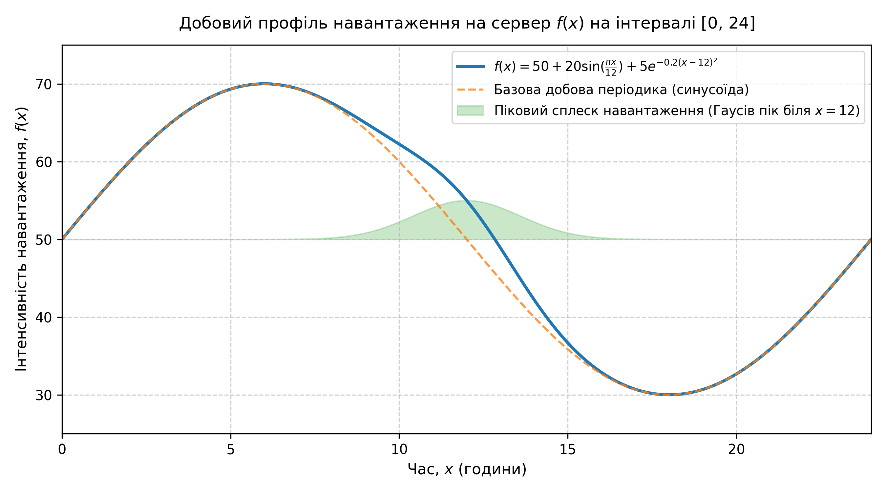
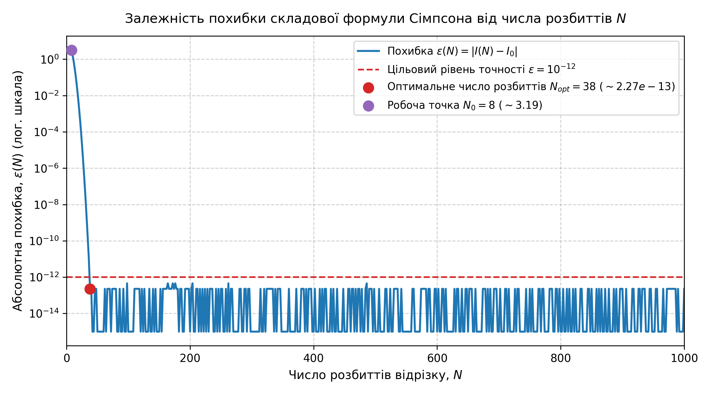
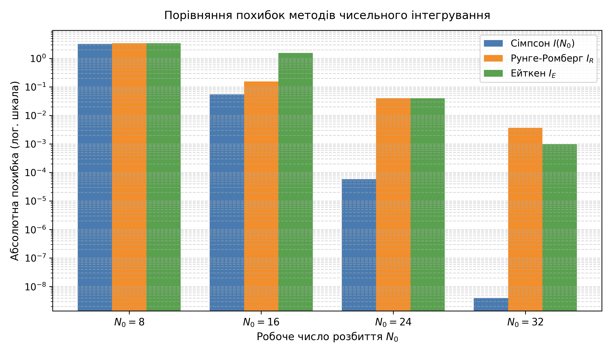
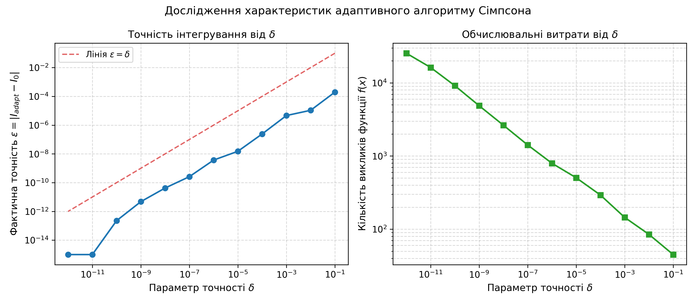
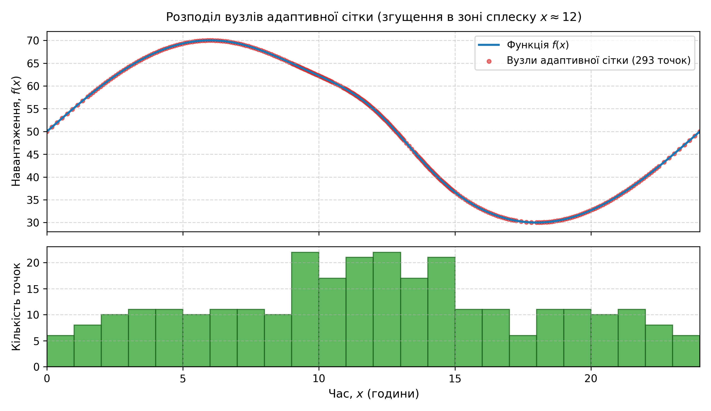

# Лабораторна робота №5: Складова квадратурна формула. Методи підвищення точності. Адаптивний алгоритм

Дослідження методів чисельного інтегрування складовою квадратурною формулою Сімпсона, підвищення точності за схемами Рунге-Ромберга та Ейткена, а також реалізація та аналіз адаптивного алгоритму зі змінним кроком для моделювання добового навантаження на сервер.

---

## 📌 Постановка задачі

У хмарних сервісах та системах мережевого моніторингу сумарне навантаження на сервер за інтервал часу $[a, b] = [0, 24]$ годин оцінюється інтегралом:
$$I_0 = \int_0^{24} f(x) \, dx$$

Інтенсивність навантаження описується аналітичною моделлю (добова гармоніка + піковий денний сплеск):
$$f(x) = 50 + 20\sin\left(\frac{\pi x}{12}\right) + 5e^{-0.2(x-12)^2}, \quad x \in [0, 24]$$

### Основні етапи дослідження:
1. **Точне аналітичне інтегрування**:
   $$I_0 = \int_0^{24} 50 \, dx + \int_0^{24} 20\sin\left(\frac{\pi x}{12}\right) dx + \int_0^{24} 5e^{-0.2(x-12)^2} dx = 1200 + 0 + 5\sqrt{5\pi}\operatorname{erf}\left(\frac{12}{\sqrt{5}}\right) \approx 1219.816636488029$$
2. **Складова формула Сімпсона**:
   $$I(N) = \frac{h}{3} \left[ f_0 + 4\sum_{k=1,3,\dots}^{N-1} f_k + 2\sum_{k=2,4,\dots}^{N-2} f_k + f_N \right], \quad h = \frac{b - a}{N}$$
   Дослідження збіжності $\varepsilon(N) = |I(N) - I_0|$ на сітці $N \in [10, 1000]$ та визначення $N_{opt}$ для цільової точності $\varepsilon \le 10^{-12}$.
3. **Розрахунок за базовим числом розбиттів $N_0 \approx N_{opt} / 10$ ($N_0$ кратне 8)**:
   Прийнято $N_0 = 8$, обчислення $I(N_0)$ та похибки $eps0 = |I(N_0) - I_0|$.
4. **Уточнення за методом Рунге-Ромберга ($p = 4$, $q = 2$)**:
   $$I_R = I(N_0) + \frac{I(N_0) - I(N_0/2)}{15}, \quad epsR = |I_R - I_0|$$
5. **Уточнення за методом Ейткена та оцінка фактичного порядку $p$**:
   $$I_E = \frac{\left(I(N_0/2)\right)^2 - I(N_0) \cdot I(N_0/4)}{2 I(N_0/2) - \left(I(N_0) + I(N_0/4)\right)}, \quad p = \frac{1}{\ln 2}\ln\left| \frac{I(N_0/4) - I(N_0/2)}{I(N_0/2) - I(N_0)} \right|$$
6. **Адаптивний рекурсивний алгоритм**:
   Інтегрування зі змінним кроком, де поділ інтервалу здійснюється за локальним критерієм:
   $$|I_i^{(1)} - I_i^{(2)}| \le \delta_i$$
   Дослідження точності $\varepsilon$ та обчислювальних витрат (кількості викликів функції $f(x)$) від параметра $\delta \in [10^{-1}, \dots, 10^{-12}]$.

---

## 📁 Структура проєкту

```text
Lab5/
├── plots/
│   ├── server_load_dynamics.png         # Профіль навантаження f(x) на [0, 24]
│   ├── simpson_error_convergence.png    # Збіжність похибки складової формули Сімпсона
│   ├── methods_comparison.png           # Порівняння похибок методів при різних N0
│   ├── adaptive_algorithm_analysis.png  # Точність та витрати адаптивного алгоритму від delta
│   └── adaptive_nodes_distribution.png  # Розподіл вузлів адаптивної сітки (згущення біля x=12)
├── main.py                              # Реалізація всіх обчислювальних методів та побудова графіків
├── results.txt                          # Збережені числові результати та таблиці
├── Report_Lab5.docx                     # Оформлений академічний звіт (MS Word)
├── Report_Lab5.pdf                      # Згенерований екземпляр звіту у форматі PDF
├── requirements.txt                     # Залежності проєкту (numpy, scipy, matplotlib, python-docx)
├── .gitignore                           # Виключення тимчасових файлів Python
└── README.md                            # Документація лабораторної роботи
```

---

## 📊 Результати розрахунків

### 1. Точне інтегрування та оптимальне розбиття
- **Аналітичний інтеграл**: $I_0 = 1219.816636488029$
- **Оптимальне число розбиттів**: $N_{opt} = 38$
- **Досягнута точність при $N_{opt}$**: $eps_{opt} = 2.273737 \times 10^{-13} \le 10^{-12}$

### 2. Результати для базової точки $N_0 = 8$
| Метод | Значення інтегралу $I$ | Абсолютна похибка $\varepsilon$ |
| :--- | :---: | :---: |
| Складова формула Сімпсона $I(N_0 = 8)$ | 1216.626890930475 | $3.189746 \times 10^{0}$ |
| Складова формула Сімпсона $I(N_0/2 = 4)$ | 1220.059726864677 | $2.430904 \times 10^{-1}$ |
| Складова формула Сімпсона $I(N_0/4 = 2)$ | 1280.000000000012 | $6.018336 \times 10^{1}$ |
| Уточнення Рунге-Ромберга $I_R$ | 1216.398035201528 | $3.418601 \times 10^{0}$ |
| Уточнення за методом Ейткена $I_E$ | 1216.418345593168 | $3.398291 \times 10^{0}$ |

- **Оцінений порядок точності методом Ейткена**: $p = 4.1261$ (теоретичний порядок $p = 4$).

### 3. Зведена таблиця методів для ряду $N_0$
| $N_0$ | Похибка Сімпсона $eps0$ | Похибка Рунге-Ромберга $epsR$ | Похибка Ейткена $epsE$ | Порядок $p$ |
| :---: | :---: | :---: | :---: | :---: |
| **8** | $3.189746 \times 10^{0}$ | $3.418601 \times 10^{0}$ | $3.398291 \times 10^{0}$ | **4.1261** |
| **16** | $5.491015 \times 10^{-2}$ | $1.540789 \times 10^{-1}$ | $1.551208 \times 10^{0}$ | **0.1310** |
| **24** | $5.794891 \times 10^{-5}$ | $4.023300 \times 10^{-2}$ | $3.999431 \times 10^{-2}$ | **3.8210** |
| **32** | $3.943114 \times 10^{-9}$ | $3.660672 \times 10^{-3}$ | $9.789561 \times 10^{-4}$ | **5.8352** |

### 4. Характеристики адаптивного алгоритму Сімпсона
| Параметр $\delta$ | Обчислений $I_{adapt}$ | Фактична похибка $\varepsilon$ | Кількість викликів $f(x)$ | Число підінтервалів |
| :---: | :---: | :---: | :---: | :---: |
| $10^{-1}$ | 1219.816833766637 | $1.9728 \times 10^{-4}$ | 45 | 11 |
| $10^{-2}$ | 1219.816647215711 | $1.0728 \times 10^{-5}$ | 85 | 21 |
| $10^{-4}$ | 1219.816636730834 | $2.4281 \times 10^{-7}$ | 293 | 73 |
| $10^{-6}$ | 1219.816636484320 | $3.7096 \times 10^{-9}$ | 797 | 199 |
| $10^{-8}$ | 1219.816636488072 | $4.2292 \times 10^{-11}$ | 2637 | 659 |
| $10^{-10}$ | 1219.816636488030 | $2.2737 \times 10^{-13}$ | 9141 | 2285 |
| $10^{-12}$ | 1219.816636488029 | $0.0000 \times 10^{0}$ | 25405 | 6351 |

---

## 📈 Графічні результати

### 1. Добовий профіль навантаження на сервер


### 2. Збіжність складової формули Сімпсона


### 3. Порівняння похибок методів


### 4. Аналіз адаптивного алгоритму


### 5. Розподіл вузлів адаптивної сітки (динамічна адаптація)


---

## 💡 Основні висновки

1. **Порядок точності**: Експериментально підтверджено теоретичний 4-й порядок точності складової формули Сімпсона ($p \approx 4.1261$ при $N_0 = 8$).
2. **Оптимальна сітка**: Задана точність $\varepsilon = 10^{-12}$ досягається при $N_{opt} = 38$ завдяки швидкій збіжності квадратури $O(h^4)$.
3. **Екстраполяційні методи**: Схеми Рунге-Ромберга та Ейткена дозволяють алгебраїчно компенсувати похибку методу при достатньому розбитті сітки, проте при грубих сітках ($h > \sigma$) їхня ефективність обмежується масштабом локальних сплесків.
4. **Ефективність адаптивного алгоритму**: Адаптивний метод автоматично концентрує обчислювальні вузли в зоні високої кривини (гаусів пік біля $x = 12$, щільність понад 33 точок/год) та розріджує їх на плавних ділянках (13 точок/год), гарантуючи стабільну точність без надлишкових обчислень.

---

## 🚀 Запуск проєкту

```bash
# Встановлення залежностей
pip install -r requirements.txt

# Виконання розрахунків та генерація графіків
python3 main.py
```
